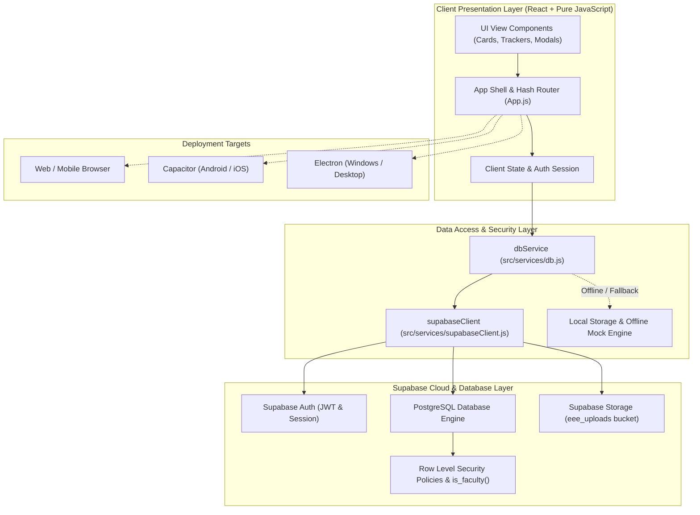
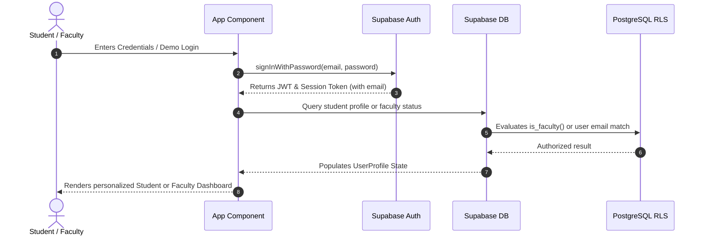
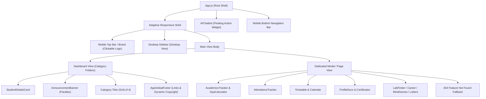

# 🏛️ Tutor Ward App - System Architecture

This document describes the high-level system architecture, component taxonomy, data flow, security model, and deployment patterns of the **Tutor Ward App** (Department of Electrical & Electronics Engineering, Sri Ramakrishna Engineering College).
- **Application**: **Tutor Ward App**
- **Lead Developer**: **Nithin Annamalai R**
- **Contact Email**: [**tutorwardapp@gmail.com**](mailto:tutorwardapp@gmail.com)

---

## 1. High-Level System Architecture

The application is engineered as a **Cross-Platform Progressive Client (SPA)** with hybrid bindings for Web browsers, Native Android/iOS (Capacitor), and Native Desktop (Electron).

---

## 2. Authentication & Role-Based Authorization

The application distinguishes between two primary user personas:
1. **Student**: Can view public notices, timetables, and their own private records (documents, grades, attendance, OD forms, letters).
2. **Faculty / Admin**: Has elevated rights to create announcements, update student dossiers, approve letter requests, upload calendar files, and view grievance submissions.

---

## 3. Database Security & Access Control Matrix

Row Level Security is enabled on **all 16 relational tables** to enforce least-privilege data access:

| Table Name | Public Read | Student Read | Student Write | Faculty / Admin Write | RLS Policy Mechanism |
|---|:---:|:---:|:---:|:---:|---|
| `announcements` | ✅ | ✅ | ❌ | ✅ | `is_faculty()` |
| `courses` | ✅ | ✅ | ❌ | ✅ | `is_faculty()` |
| `faculty` | ✅ | ✅ | ❌ | ✅ | `is_faculty()` |
| `rules` | ✅ | ✅ | ❌ | ✅ | `is_faculty()` |
| `milestones` | ✅ | ✅ | ❌ | ✅ | `is_faculty()` |
| `labs` | ✅ | ✅ | ❌ | ✅ | `is_faculty()` |
| `calendar_files` | ✅ | ✅ | ❌ | ✅ | `is_faculty()` |
| `timetable_files` | ✅ | ✅ | ❌ | ✅ | `is_faculty()` |
| `timetable_entries` | ✅ | ✅ | ❌ | ✅ | `is_faculty()` |
| `lab_seats` | ✅ | ✅ | ❌ | ✅ | `is_faculty()` |
| `student_profiles` | ❌ | Own profile | Own profile | All profiles | `email = auth.jwt() ->> 'email' OR is_faculty()` |
| `student_documents` | ❌ | Own documents | Own documents | All documents | `student_email = auth.jwt() ->> 'email' OR is_faculty()` |
| `letter_requests` | ❌ | Own requests | Own (Pending only) | All (Approve/Reject) | `student_email = auth.jwt() ->> 'email' OR is_faculty()` |
| `od_requests` | ❌ | Own ODs | Own (Pending only) | All (Approve/Reject) | `student_email = auth.jwt() ->> 'email' OR is_faculty()` |
| `attendance_logs` | ❌ | Own roll number | ❌ | All logs | Roll number lookup OR `is_faculty()` |
| `suggestions` | ❌ | ❌ | Any student | Full review | `INSERT: true, SELECT/DELETE: is_faculty()` |

---

## 4. Insecure Direct Object Reference (IDOR) Defense

To prevent IDOR vulnerabilities (e.g., student A accessing student B's records by tampering with query parameters or IDs):
1. **Server-Side Filtering**: Database queries in `src/services/db.js` explicitly append `.eq('student_email', currentUser.email)` on Supabase rather than filtering client-side.
2. **Database-Enforced Authorization**: Even if a malicious client bypasses the frontend and queries Supabase directly, PostgreSQL RLS immediately rejects any read, update, or delete on rows where the JWT email does not match the record owner.

---

## 5. Component Taxonomy & Layout Tree

---

## 6. Offline-First & Resilient Fallback Strategy

The application is structured to ensure 100% uptime for students even under poor network conditions:
- When network is connected, Supabase updates seamlessly.
- If network drops or Supabase credentials are unavailable during offline lab sessions, `db.js` stores updates in `localStorage` under namespaced keys (`eee_students`, `eee_letter_requests`, `eee_od_requests`).
- Upon connection restoration, the user can continue without application crashes or white-screens.

